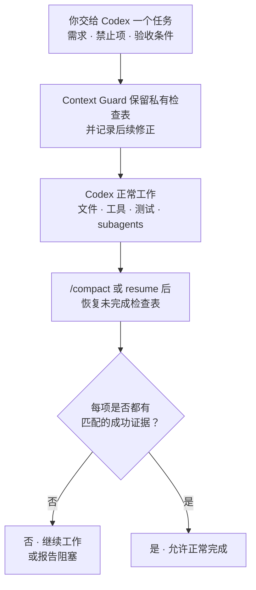

# Context Guard

[](https://github.com/GreenLv/codex-context-guard/actions/workflows/ci.yml)
[](https://github.com/GreenLv/codex-context-guard/actions/workflows/hol-plugin-scanner.yml)
[](https://hol.org/registry/plugins/gerui-lv%2Fcontext-guard)
[](https://github.com/GreenLv/codex-context-guard/releases/latest)
[](LICENSE)

[English](README.md) | [介绍文章](https://blog.csdn.net/LvGreat/article/details/163534498) | [更新日志](CHANGELOG.zh-CN.md)

Context Guard 帮 Codex 在长任务里记住你交代过的要求。执行 `/compact` 或恢复任务后，它会找回尚未完成的事项。Codex 说整个任务完成时，它会核对有没有对应的证据。

例如，你要求改一个文件并运行测试。读取文件成功，不能证明改过文件，也不能证明测试跑过。平时修改文件、提交和推送，仍按 Codex 的权限运行。

**最新发布版是 0.17.2。** 如果已有任务依赖旧插件，请先完成这些任务。升级指南说明如何更新稳定入口并保留清理设置。[发布说明](docs/releases/v0.17.2.md) · [升级指南](docs/UPGRADE_0_17_2.zh-CN.md)

## 用 Codex 安装

需要 Python 3.10 或更新版本，以及能加载插件和自动脚本（Hook）的 Codex 客户端。先运行 `codex plugin list --json`。如果列表里已有任何 Context Guard 入口，请按[升级指南](docs/UPGRADE_0_17_2.zh-CN.md)选择路线。下面是首次安装的步骤。

1. 从[发布附件](https://github.com/GreenLv/codex-context-guard/releases/tag/v0.17.2)下载 `context-guard-0.17.2.zip`，核对发布页公布的 SHA-256。把 ZIP 解压到自己管理的目录，之后保留这个目录作为市场来源。发行 ZIP 带有核验用的文件清单。
2. 在解压后的目录运行以下命令，注册市场并安装插件：

   ```shell
   codex plugin marketplace add .
   codex plugin add context-guard@codex-context-guard --json
   codex plugin list --json
   ```

3. 核对列表里只有一条 `context-guard@codex-context-guard` 记录，版本是 `0.17.2`，已安装且已启用，市场来源指向刚才的解压目录。保存安装命令返回的 `installedPath`。核对已安装文件时，将下例双引号里的路径替换成该值。Windows 上用 `py -3` 代替 `python3`。

   ```shell
   python3 scripts/artifact_identity.py --compare-to "/path/from/installedPath"
   ```

4. 用同一份 Codex 配置新开一个 CLI 任务，输入 `/hooks`。确认九项 Context Guard Hook 都来自 `<installedPath>/hooks/hooks.json`，再信任它们。条目缺失或来源不符时先检查安装。然后回到自己日常使用的客户端试用，Desktop 可能需要重启后才加载新入口。

如果新任务找不到 Python，或仍加载旧版，请查[兼容性](docs/COMPATIBILITY.md)和[升级指南](docs/UPGRADE_0_17_2.zh-CN.md)。复查安装时，重新看列表和比较文件即可。重复运行 `plugin add` 可能重建缓存。

## 试用

在全新任务中启用 Context Guard：

```text
$context-guard
```

然后检查受保护状态：

```text
context-guard status
context-guard diagnose
```

想试一下恢复，可以在新任务里交代两三条要求，保留一项未完成，然后执行 `/compact`。压缩后，请 Codex 列出还没完成的要求，核对它是否还记得。

完整操作示例见 [HOL 上的 Context Guard 实践教程（英文）](https://hol.org/blog/context-guard-codex-compaction-evidence-workflow)：先定义文档要求，再压缩任务，最后核对恢复出的要求和完成的文档。

## 它保护什么

- 需求、验收条件、禁止项和后续修正都有稳定的任务内 ID。
- 上下文压缩和任务恢复会还原未完成检查表，不只依赖会话摘要。
- 工具证据必须对应指定的文件、URL、图片或其他结果，才能关闭对应条目。
- 答复送达不等于任务完成。纯问题的自然答复真正送达后，该条目以 `answered` 关闭，压缩后不再重放；执行义务始终需要证据；未知送达状态绝不会冒充完成。
- 图片等多模态输入只保存哈希和必要元数据；如果用户要求修改图片，完成证据可以绑定到修改后的图片回读，而不只是“工具运行成功”。
- 含糊输出保持 `unknown`（未知）；私有状态损坏或无法验证时，不能通过完成核验。
- 导出必须显式触发并经过脱敏。图片字节、凭据和会话正文不会复制进需求记录。

如果目标是指定文件、URL、修改后的图片或完整对象清单，Context Guard 可以要求对应的证据。缺少证据时，这项检查保持待办。遇到无法这样核验的请求，它会标明 `legacy_fallback`，改用较通用的完成检查。等待用户、外部结果或后续处理时，未完成的要求仍保留。

## 谁决定什么

- 用户决定任务目标以及允许哪些变更。
- 仓库说明和已选择的 Skill 规定工作流程，但不能增加授权。
- Codex Plan 记录模型当前的执行步骤；Context Guard 可以保留只读引用，但不会修改计划。
- 工具、文件、图片、UI 和公开页面的读回只说明事实，它们本身不能决定一个动作是否获得授权。

从 0.13 开始，职责这样分工：

- **执行授权由你和主执行 Agent 决定。** 一次编辑、提交、推送、打标签或发布是否在你的授权范围内，由主执行 Agent 依据真实对话、仓库规则和宿主权限判断，而不是由 Context Guard 提示决定。Context Guard 的放行从来不是授权，现在产品把这一点写明。
- **Context Guard 负责正确性连续。** 它在压缩和恢复后还原要求与约束，保持任务状态连续，用匹配的确定性证据核对完成声明，跟踪要求的答复是否真正送达，并保护自己的私有控制状态。这些检查保持 fail-closed，也绝不会要求你重新授权普通工作。
- **显式采用的发布执行合同负责精确身份动作。** 只有显式采用或显式 `context-guard release` 声明之后，tier-A 动作——打标签、registry publish/yank、GitHub Release——才需要精确的一次性动作票据。

Context Guard 不授予权限，也不替代平台审批；未接入 Hook 的专用工具仍在它的视野之外。

## 保护级别

Context Guard 的检查强度跟随当前保护级别。Skill、仓库说明或安装插件只能"建议"级别，只有你能打开更严格的级别。

| 级别 | 如何开启 | 实际行为 |
| --- | --- | --- |
| **standard**（默认） | 启用守卫 | 在压缩和恢复后还原你的要求，保持任务状态连续，依据确定性证据诚实核对完成，并跟踪答复送达。没有执行审批，也不会反复要求授权：普通编辑、提交、推送、状态提问和压缩都不会触发 Context Guard 提示。 |
| **strict** | 你明确要求严格证据保护 | standard 之外，对当前工作单元启用强制证明义务——适合正式交付和多图任务。strict 绝不暗示发布或 Git 门禁。 |
| **release** | 只有显式采用的发布执行合同或显式 `context-guard release` 声明 | standard 之外，对已覆盖的 tier-A 身份动作（打标签、registry publish/yank、GitHub Release）要求候选闭包、发布就绪凭据和精确的一次性票据。标签或 Release 的授权永远不会自动成立。 |
| **observe** | 维护者或灰度配置 | 只记录有界的"本来会怎样"结果，不实际拦截。 |

其余保持开放：本地修改、测试、普通提交、读取、搜索和 dry-run 不需要额外的 Context Guard 审批；`context-guard off` 会停止全部门禁，仅保留提示记录。普通动作被放行时屏幕上什么都不会出现；动作被拒绝时——发布合同票据失败或完整性失败——你会看到一句可操作的简短原因。

## 工作流程



工作过程和原生计划状态仍由 Codex 管理。Context Guard 负责跨上下文保留检查表；项目显式采用仓库说明后，它还会恢复未完成阶段和计划引用，再核对任务是否完成。

## 日常示例：撰写技术方案，但不能漏掉已确认决策

假设任务是：

```text
编写 docs/design/checkout-v2.md。

- 保持已确认的 API 和数据流决策不变。
- 不修改上线日期，不新增基础设施承诺。
- 使用 RFC 模板。
- 每条建议都提供来源链接，或标注“待确认”。
```

经过调研、修改、绘图和 `/compact` 后，Context Guard 恢复相同检查项。Markdown 检查通过不能代表整个任务完成：已确认决策、RFC 模板、来源链接和禁止项仍需各自证据。

这个例子只说明契约边界，不表示 Context Guard 能判断技术方案本身是否合理。

同样的边界也适用于日常执行。当你说"完成修改，提交并推送"后，普通编辑、提交、推送、状态提问和压缩都不会再触发 Context Guard 重新授权，`/compact` 前后都是如此。回复声称整个任务完成时，仍需要与未完成事项匹配的证据。

## 在受保护任务中可能看到什么

| ID | 含义 |
| --- | --- |
| `R001` | 当前任务捕获的一条需求。 |
| `A003` | 需要独立检查的一条验收项。 |
| `E####` | 可以关闭兼容条目的成功证据记录。 |

这些都是任务内 ID，不是 GitHub issue 或全局任务编号。它们可能出现在进度说明中，但私有记录不会原样打印在最终回复里。

## 看到“任务尚未安全完成”时

当仍有要求缺少匹配证据、而回复声称整个任务已完成时，Context Guard 可能用下面这条标准脱敏提示要求 Codex 继续：

```text
[Context Guard continuation] The task is not yet safely complete.
```

确实还有工作未完成时，这条提示属于正常保护。如果提示与预期不符，可以直接问 Codex 还缺什么，并运行 `context-guard status` 或 `context-guard diagnose`。默认反馈只提到当前工作单元的未验项数量、一个原因和一个下一步，不会罗列全部历史 ID；每回合最多纠正一次，之后未完成的工作保持待办，回合安全结束。等待用户、外部结果或明确延期的回合会静默结束，不会关闭未完成要求。普通结束不需要任何命令：回复可验证地完成当前单元时，守卫会自行绑定唯一的成功证据。

原地升级后，旧任务不保证继续使用原 Hook。切换版本前请遵循[会话存储与升级](docs/SESSION_STORAGE.md)；如果旧 Hook 路径缺失，请按[版本策略](docs/VERSIONING.md)中的说明恢复。

## 用户控制

| 命令 | 用途 |
| --- | --- |
| `$context-guard` 或 `context-guard on` | 启用恢复和完成门禁。 |
| `context-guard off` | 关闭门禁，但继续记录提示变更。 |
| `context-guard standard\|strict\|release\|observe` | 显式选择保护级别；`release` 不会授权任何发布操作。 |
| `context-guard adopt <project-relative-json>` | 显式采用一份已经验证的项目执行合同。 |
| `context-guard status` | 查看保护状态计数，不暴露原始提示。 |
| `context-guard diagnose` | 查看有界诊断，不暴露原始提示或回复。 |
| `context-guard export <path>` | 在当前项目中显式写出脱敏交接文件。 |
| `context-guard rollover <directory>` | 验证准备好的后续任务输入，写出不可覆盖的交接文件与哈希清单。 |

使用 `rollover` 前请阅读[后续任务输入说明](skills/context-guard/references/successor-pack.md)。它不会创建或授权另一个任务。

## 私有数据与保留期

Context Guard 把任务记录保存在本机的插件数据目录。只有你要求导出时，它才生成脱敏交接文件，并保留目标位置已有的文件。具体遮盖哪些信息见[隐私说明](docs/PRIVACY.md)。命令行未指定插件数据目录时，使用当前 `CODEX_HOME` 下的数据。

从 0.17.2 起，结束会话时可自动启动清理。结束超过 30 天且符合条件的会话可以进入可恢复的隔离区，隔离至少 7 天后，后续维护可以永久删除。已禁用的策略、自定义保留期、仅隔离模式和持久关闭记录仍然优先。损坏的策略不会授权删除。在发行包解压目录运行 `python3 scripts/context_guard.py cleanup --data-dir "/path/to/plugin-data"` 可以预览维护内容。加上 `--policy show` 可以查看生效策略与最近一次自动维护记录。定时维护仍可另行开启。

还在使用、尚未完成、可以续接或采用旧格式的会话会保留。清理工具也会保留无法确认身份的目录。[会话存储与清理](docs/SESSION_STORAGE.md)说明如何操作、怎么恢复，以及哪些情况下扫描会报告尚未完成。

## 更新与卸载

发行制品解压目录中不要运行 `git pull`。后续版本请另存明确命名的已发布制品，
完成依赖当前版本的任务后，再按该版本的升级说明操作。不要覆盖已消费缓存，
也不要在安装本版本时刷新旧市场。

移除插件会删除所选插件的缓存。先结束依赖它的任务，再用下面的命令移除稳定入口：

```shell
codex plugin remove context-guard@codex-context-guard
codex plugin marketplace remove codex-context-guard
```

0.16.x 留下的实验性 `codex-context-guard-v016` 条目有自己的缓存和卸载命令；
在其任务或缓存仍被依赖时不要移除。

私有运行数据单独保存，卸载后，任务记录仍在原目录。

## 文档

- [升级到 0.17.2](docs/UPGRADE_0_17_2.zh-CN.md)
- [会话存储与清理](docs/SESSION_STORAGE.md)
- [文档索引](docs/README.md)
- [更新日志](CHANGELOG.zh-CN.md)

## 验证

开发检查命令见[贡献指南](CONTRIBUTING.md)，实际测过的平台和版本见[本地验收](docs/LOCAL_ACCEPTANCE.md)。CI 覆盖 Ubuntu、macOS、Windows 及 Python 3.10–3.14。安装后 Hook 的实际表现另有验收记录。

## 明确不做

- Context Guard 只核对能够确定性验证的结果，不能证明任意文字或图片的内容正确，也不能替代测试和人工审查。
- 它不提供安全沙箱、会话备份、云同步或 Agent 调度。Plan、Goal 和执行仍由 Codex 管理。
- 它不授予权限。发布仍需就绪检查、用户与宿主授权，以及公开读回。

恢复和完成契约不依赖模型或 Agent 宿主自带上下文保护能力。协议与 Codex 适配层的说明见[架构文档](docs/ARCHITECTURE.md)。

只有发起根任务的用户才能通过 `context-guard adopt <project-relative-json>` 采用项目流程和计划引用。采用不会修改 Codex Plan，也不会增加权限。安装 Skill 或在文字中提到计划不构成采用；发布控制仍需按上文显式选择。

## 贡献与安全

开发说明见 [CONTRIBUTING.md](CONTRIBUTING.md)。敏感问题请按 [SECURITY.md](SECURITY.md)通过 GitHub Private Vulnerability Reporting 报告。

项目采用 [Apache License 2.0](LICENSE)。
