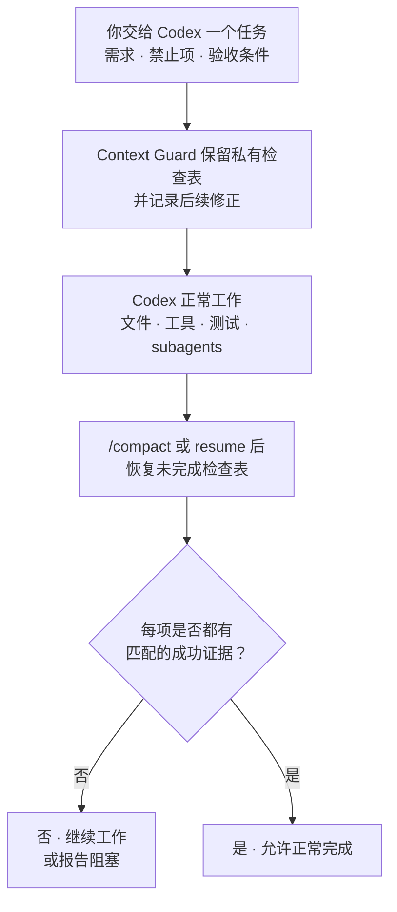

# Context Guard

[](https://github.com/GreenLv/codex-context-guard/actions/workflows/ci.yml)
[](https://github.com/GreenLv/codex-context-guard/actions/workflows/hol-plugin-scanner.yml)
[](https://hol.org/registry/plugins/gerui-lv%2Fcontext-guard)
[](https://github.com/GreenLv/codex-context-guard/releases/latest)
[](LICENSE)

[English](README.md) | [介绍文章](https://blog.csdn.net/LvGreat/article/details/163534498) | [更新日志](CHANGELOG.zh-CN.md)

Context Guard 防止长时间 Codex 任务在上下文压缩后漏掉关键要求。它在上下文压缩或恢复任务后还原私有检查表，并核对已记录的证据，再判断任务是否完成。

它与 Codex 的 Plan、Goal、记忆、子 Agent、工作树和会话记录配合工作。普通编辑、提交和推送仍使用 Codex 的现有权限机制。

> **0.16.0 — Unreleased。** 本版加强凭据脱敏，保护既有导出文件与项目目录权限，验证私有状态权限，并改用 Codex 官方市场命令安装。会话身份会先验证，数据按 `CODEX_HOME` 隔离，SessionEnd 清理使用有界工作预算。公开可用状态由 [GitHub Release 读回](https://github.com/GreenLv/codex-context-guard/releases)单独确定；修改安装前，请阅读[发布说明](docs/releases/v0.16.0.md)、[升级边界](docs/SESSION_STORAGE.md)与[验收记录](docs/LOCAL_ACCEPTANCE.md)。

## 用 Codex 安装

**0.16.0 — Unreleased。** 实验性市场名为
`codex-context-guard-v016`，与已发布的 0.15.1 市场不同。真实旧任务续接、
两个版本独立启停和 GUI 启动尚未验证。

正式发布后，请下载明确命名的发行制品 `context-guard-0.16.0.zip`；此前请按下方命令构建候选制品。不要把 Git 检出目录或 GitHub 自动源码 ZIP 注册为市场，
它们带有仓库维护文件。把发行 ZIP 解压到自己控制的稳定目录并一直保留，
官方市场后续读取和刷新仍依赖此来源，不要在安装后删除。

维护者可从本检出构建 ZIP，输出到检出目录外的新路径，需要 Python 3.10+：

```shell
python3 scripts/build_release_artifact.py --output ../context-guard-0.16.0.zip
```

Windows 的 Python 命令请把 `python3` 替换为 `py -3`。还需要支持插件的
Codex CLI 和能加载生命周期 Hook 的宿主。从稳定的解压目录先读官方状态：

```shell
codex plugin list --json
```

如果原 `context-guard@codex-context-guard` 仍已启用，且未完成任务依赖它，
请先停在这里，等这些任务完成。暂不接受切换时保持原设置，或另行配置独立
HOME；本版本不能证明旧任务会自动续接。

只有当 `context-guard@codex-context-guard-v016` 不存在时，才注册并安装：

```shell
codex plugin marketplace add .
codex plugin add context-guard@codex-context-guard-v016 --json
codex plugin list --json
```

请保存首次 add 的返回结果，用其中的 `installedPath` 确认待核验缓存。
`plugin list` 提供身份、版本、已安装/已启用状态及市场来源，不提供缓存路径。
必须恰好有一条完整身份匹配的记录，版本为 `0.16.0`，两项状态均为 true，
来源是该稳定解压目录。请把下例双引号内的占位路径替换为完整的
`installedPath` 返回值，并保留双引号，以支持路径中的空格：

```shell
python3 scripts/artifact_identity.py --compare-to "/path/from/installedPath"
```

目标已经安装时，只执行同样的状态、身份和完整文件核对，然后停止，不再注册
或 add。首次安装读回丢失、身份不唯一、版本或来源不符、任何文件漂移都应
报错停止，不猜测路径，也不通过重装修复。裸重复 `plugin add` 可能重建缓存
对象；只有完整的先检查流程才可能在第二次达到 no-op，不声称 CLI add 幂等。
原生门比较整个 HOME 最终的路径、模式与文件字节，不证明期间从未写入；
合成旧缓存额外核对对象身份。

本版本删除项目自有安装器、事务回滚、归档修复和自动解释器绑定，由 Codex
负责安装。相应原生门完成前，请保留既有 0.15.1 对象和日常配置。新市场名
本身不能证明缓存保护或旧任务续接。信任新版 Hook 前，再检查原
`context-guard@codex-context-guard` 标识；若它仍已启用，先结束所有依赖旧版的
任务，再通过官方 Plugins UI 只禁用原标识，保持
`context-guard@codex-context-guard-v016` 已启用。不要 remove 旧插件或删除旧缓存，
也不要把同时信任两套 Hook 当作升级流程。桌面端可能需要重启；随后使用相同
`CODEX_HOME` 和项目启动新的 Codex CLI 任务，输入 `/hooks`。逐项核对九个
Context Guard 事件显示的来源，应为首次 add 返回的
`<installedPath>/hooks/hooks.json`，再通过正常界面检查并信任。若条目缺失、
来源不符或界面不显示来源，请停止。[Hook 浏览器](https://learn.chatgpt.com/docs/hooks)
展示的是定义和信任状态，不能证明 Hook 已执行或桌面端已加载。真实
macOS/Windows 切换及旧任务续接仍须独立原生验收。

### Python 与升级

既有 `<CODEX_HOME>/context-guard/interpreter.conf` 仍可读取并运行时验证，
但本版本不创建绑定，错误绑定仍明确失败。PATH 发现失败后，POSIX 启动器
只探测固定的全局安装位置：Homebrew（`/opt/homebrew/bin` 或 `/usr/local/bin`，
含 Python 3.10–3.14 的版本名）、`/opt/anaconda3/bin` 和 Python.framework。
每个候选都必须通过隔离的 Python 3.10+ 探针并返回唯一标识；不会搜索个人
目录或写入绑定，其他位置仍需 PATH 或有效显式绑定。Windows 仍需原有
PATH/launcher 或绑定；启动和查找缺失解释器时不再扫描无关 PowerShell 模块。受限 PATH 测试不等于任一平台的实际 GUI
重启验收。

更改所选插件前，应先在原运行时完成旧任务；旧缓存本身不能固定旧任务 Hook。
本版本不迁移会话或信任数据，独立 HOME 与旧任务续接仍待原生验收。
详见[升级边界](docs/SESSION_STORAGE.md)和[安装变更](docs/INSTALLER_REMOVAL.md)。

## 试用

在全新任务中启用 Context Guard：

```text
$context-guard
```

然后检查受保护状态：

```text
context-guard status
context-guard diagnose
```

验证恢复链时，请使用一个非简单的合成任务，执行 `/compact`，并确认未完成要求随即恢复出来。

完整操作示例见 [HOL 上的 Context Guard 实践教程（英文）](https://hol.org/blog/context-guard-codex-compaction-evidence-workflow)：先定义文档要求，再压缩任务，最后核对恢复出的要求和完成的文档。

## 它保护什么

- 需求、验收条件、禁止项和后续修正都有稳定的任务内 ID。
- 上下文压缩和任务恢复会还原未完成检查表，不只依赖会话摘要。
- 工具证据必须对应指定的文件、URL、图片或其他结果，才能关闭对应条目。
- 答复送达不等于任务完成。纯问题的自然答复真正送达后，该条目以 `answered` 关闭，压缩后不再重放；执行义务始终需要证据；未知送达状态绝不会冒充完成。
- 图片等多模态输入只保存哈希和必要元数据；如果用户要求修改图片，完成证据可以绑定到修改后的图片回读，而不只是“工具运行成功”。
- 含糊输出保持 `unknown`（未知）；私有状态损坏或无法验证时，不能通过完成核验。
- 导出必须显式触发并经过脱敏。图片字节、凭据和会话正文不会复制进需求记录。

只有目标足够具体时，Context Guard 才会自动核对，例如指定文件、URL、修改后的图片或必须全部覆盖的对象清单。如果无法精确验证，它会保留待办，而不是猜测结果。等待用户、外部结果或后续处理不会关闭未完成要求。

## 谁决定什么

- 用户决定任务目标以及允许哪些变更。
- 仓库说明和已选择的 Skill 规定工作流程，但不能增加授权。
- Codex Plan 记录模型当前的执行步骤；Context Guard 可以保留只读引用，但不会修改计划。
- 工具、文件、图片、UI 和公开页面的读回只说明事实，它们本身不能决定一个动作是否获得授权。

从 0.13 开始，职责这样分工：

- **执行授权由你和主执行 Agent 决定。** 一次编辑、提交、推送、打标签或发布是否在你的授权范围内，由主执行 Agent 依据真实对话、仓库规则和宿主权限判断，而不是由 Context Guard 提示决定。Context Guard 的放行从来不是授权，现在产品把这一点写明。
- **Context Guard 负责正确性连续。** 它在压缩和恢复后还原要求与约束，保持任务状态连续，用匹配的确定性证据核对完成声明，跟踪要求的答复是否真正送达，并保护自己的私有控制状态。这些检查保持 fail-closed，也绝不会要求你重新授权普通工作。
- **显式采用的发布执行合同负责精确身份动作。** 只有显式采用或显式 `context-guard release` 声明之后，tier-A 动作——打标签、registry publish/yank、GitHub Release——才需要精确的一次性动作票据。

Context Guard 不授予权限，也不替代平台审批；未接入 Hook 的专用工具仍在它的视野之外。

## 保护级别

Context Guard 的检查强度跟随当前保护级别。Skill、仓库说明或安装插件只能"建议"级别，只有你能打开更严格的级别。

| 级别 | 如何开启 | 实际行为 |
| --- | --- | --- |
| **standard**（默认） | 启用守卫 | 在压缩和恢复后还原你的要求，保持任务状态连续，依据确定性证据诚实核对完成，并跟踪答复送达。没有执行审批，也不会反复要求授权：普通编辑、提交、推送、状态提问和压缩都不会触发 Context Guard 提示。 |
| **strict** | 你明确要求严格证据保护 | standard 之外，对当前工作单元启用强制证明义务——适合正式交付和多图任务。strict 绝不暗示发布或 Git 门禁。 |
| **release** | 只有显式采用的发布执行合同或显式 `context-guard release` 声明 | standard 之外，对已覆盖的 tier-A 身份动作（打标签、registry publish/yank、GitHub Release）要求候选闭包、发布就绪凭据和精确的一次性票据。标签或 Release 的授权永远不会自动成立。 |
| **observe** | 维护者或灰度配置 | 只记录有界的"本来会怎样"结果，不实际拦截。 |

其余保持开放：本地修改、测试、普通提交、读取、搜索和 dry-run 不需要额外的 Context Guard 审批；`context-guard off` 会停止全部门禁，仅保留提示记录。普通动作被放行时屏幕上什么都不会出现；动作被拒绝时——发布合同票据失败或完整性失败——你会看到一句可操作的简短原因。

## 工作流程



工作过程和原生计划状态仍由 Codex 管理。Context Guard 负责跨上下文保留检查表；项目显式采用仓库说明后，它还会恢复未完成阶段和计划引用，再核对任务是否完成。

## 日常示例：撰写技术方案，但不能漏掉已确认决策

假设任务是：

```text
编写 docs/design/checkout-v2.md。

- 保持已确认的 API 和数据流决策不变。
- 不修改上线日期，不新增基础设施承诺。
- 使用 RFC 模板。
- 每条建议都提供来源链接，或标注“待确认”。
```

经过调研、修改、绘图和 `/compact` 后，Context Guard 恢复相同检查项。Markdown 检查通过不能代表整个任务完成：已确认决策、RFC 模板、来源链接和禁止项仍需各自证据。

这个例子只说明契约边界，不表示 Context Guard 能判断技术方案本身是否合理。

同样的边界也适用于日常执行。当你说"完成修改，提交并推送"后，普通编辑、提交、推送、状态提问和压缩都不会再触发 Context Guard 重新授权，`/compact` 前后都是如此。回复声称整个任务完成时，仍需要与未完成事项匹配的证据。

## 在受保护任务中可能看到什么

| ID | 含义 |
| --- | --- |
| `R001` | 当前任务捕获的一条需求。 |
| `A003` | 需要独立检查的一条验收项。 |
| `E####` | 可以关闭兼容条目的成功证据记录。 |

这些都是任务内 ID，不是 GitHub issue 或全局任务编号。它们可能出现在进度说明中，但私有记录不会原样打印在最终回复里。

## 看到“任务尚未安全完成”时

当仍有要求缺少匹配证据、而回复声称整个任务已完成时，Context Guard 可能用下面这条标准脱敏提示要求 Codex 继续：

```text
[Context Guard continuation] The task is not yet safely complete.
```

确实还有工作未完成时，这条提示属于正常保护。如果提示与预期不符，可以直接问 Codex 还缺什么，并运行 `context-guard status` 或 `context-guard diagnose`。默认反馈只提到当前工作单元的未验项数量、一个原因和一个下一步，不会罗列全部历史 ID；每回合最多纠正一次，之后未完成的工作保持待办，回合安全结束。等待用户、外部结果或明确延期的回合会静默结束，不会关闭未完成要求。普通结束不需要任何命令：回复可验证地完成当前单元时，守卫会自行绑定唯一的成功证据。

原地升级后，旧任务不保证继续使用原 Hook。切换版本前请遵循[会话存储与升级](docs/SESSION_STORAGE.md)；如果旧 Hook 路径缺失，请按[版本策略](docs/VERSIONING.md)中的说明恢复。

## 用户控制

| 命令 | 用途 |
| --- | --- |
| `$context-guard` 或 `context-guard on` | 启用恢复和完成门禁。 |
| `context-guard off` | 关闭门禁，但继续记录提示变更。 |
| `context-guard standard\|strict\|release\|observe` | 显式选择保护级别；`release` 不会授权任何发布操作。 |
| `context-guard adopt <project-relative-json>` | 显式采用一份已经验证的项目执行合同。 |
| `context-guard status` | 查看保护状态计数，不暴露原始提示。 |
| `context-guard diagnose` | 查看有界诊断，不暴露原始提示或回复。 |
| `context-guard export <path>` | 在当前项目中显式写出脱敏交接文件。 |
| `context-guard rollover <directory>` | 验证准备好的后续任务输入，写出不可覆盖的交接文件与哈希清单。 |

使用 `rollover` 前请阅读[后续任务输入说明](skills/context-guard/references/successor-pack.md)。它不会创建或授权另一个任务。

## 私有数据与保留期

运行时数据写入 Codex 管理的 `PLUGIN_DATA`。提示正文、任务状态、证据摘要和恢复文件都属于本地运行时数据，不属于本仓库。

已结束且未恢复活动的 v2 会话在 30 天后可以清理；legacy 会话树继续保留，保留清理保持在 SessionEnd 三秒预算之内。脱敏导出只在显式请求时创建，绝不覆盖既有文件，并省略原始提示、会话正文、凭据、认证头、URL 查询参数、URL userinfo 和插件私有路径；文档化脱敏域见[隐私说明](docs/PRIVACY.md)。未提供插件数据目录时，直接 CLI 回退状态存放在当前生效的 `CODEX_HOME` 之下。

## 更新与卸载

发行制品解压目录中不要运行 `git pull`。后续版本请另存明确命名的已发布制品，
完成依赖当前版本的任务后，再按该版本的升级说明操作。不要覆盖已消费缓存，
也不要在安装本版本时刷新旧市场。

移除插件会删除所选插件的缓存。活动任务仍可能依赖它时不要移除。
这些任务结束后，下列命令仅指定新的 0.16.0 标识；真实 0.15.1 缓存对象是否
保持不变仍未验证：

```shell
codex plugin remove context-guard@codex-context-guard-v016
codex plugin marketplace remove codex-context-guard-v016
```

私有运行数据单独保存，此流程不迁移或删除它。

## 文档

- [架构](docs/ARCHITECTURE.md)
- [隐私](docs/PRIVACY.md)
- [兼容性](docs/COMPATIBILITY.md)
- [版本策略](docs/VERSIONING.md)
- [本地验收](docs/LOCAL_ACCEPTANCE.md)
- [更新日志](CHANGELOG.zh-CN.md)

## 验证

```shell
python3 scripts/validate_public_repo.py .
python3 scripts/audit_public_tree.py .
python3 scripts/run_current_behavior_suite.py
python3 scripts/check_phase3_transition.py
python3 scripts/context_guard.py self-test
ruff check .
python3 -m compileall -q scripts tests tools
git diff --check
```

current-behavior runner 会发现除字节冻结的 0.11.x 观察基线外的全部当前 `test_*.py` 模块。transition 审计会单独运行该历史基线，并且只有 fixed/inverted 精确清单一致时才成功；若把冻结文件当成普通的“全部应通过”套件直接发现，它会按设计报告失败与 unexpected success。

Hook 运行时只使用 Python 标准库。CI 覆盖 Ubuntu、macOS、Windows 和 Python 3.10–3.14；CI 不能替代原生 Hook 信任或已安装生命周期证据。

## 明确不做

- Context Guard 只核对能够确定性验证的结果，不能证明任意文字或图片的内容正确，也不能替代测试和人工审查。
- 它不提供安全沙箱、会话备份、云同步或 Agent 调度。Plan、Goal 和执行仍由 Codex 管理。
- 它不授予权限。发布仍需就绪检查、用户与宿主授权，以及公开读回。

恢复和完成契约不依赖模型或 Agent 宿主自带上下文保护能力。协议与 Codex 适配层的说明见[架构文档](docs/ARCHITECTURE.md)。

只有发起根任务的用户才能通过 `context-guard adopt <project-relative-json>` 采用项目流程和计划引用。采用不会修改 Codex Plan，也不会增加权限。安装 Skill 或在文字中提到计划不构成采用；发布控制仍需按上文显式选择。

## 贡献与安全

开发说明见 [CONTRIBUTING.md](CONTRIBUTING.md)。敏感问题请按 [SECURITY.md](SECURITY.md)通过 GitHub Private Vulnerability Reporting 报告。

项目采用 [Apache License 2.0](LICENSE)。
